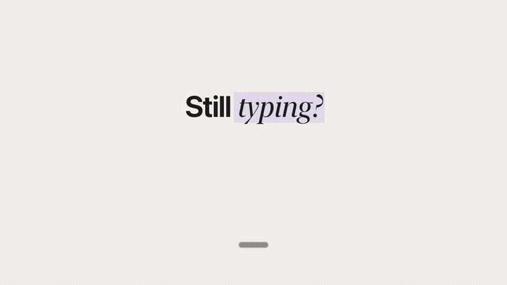
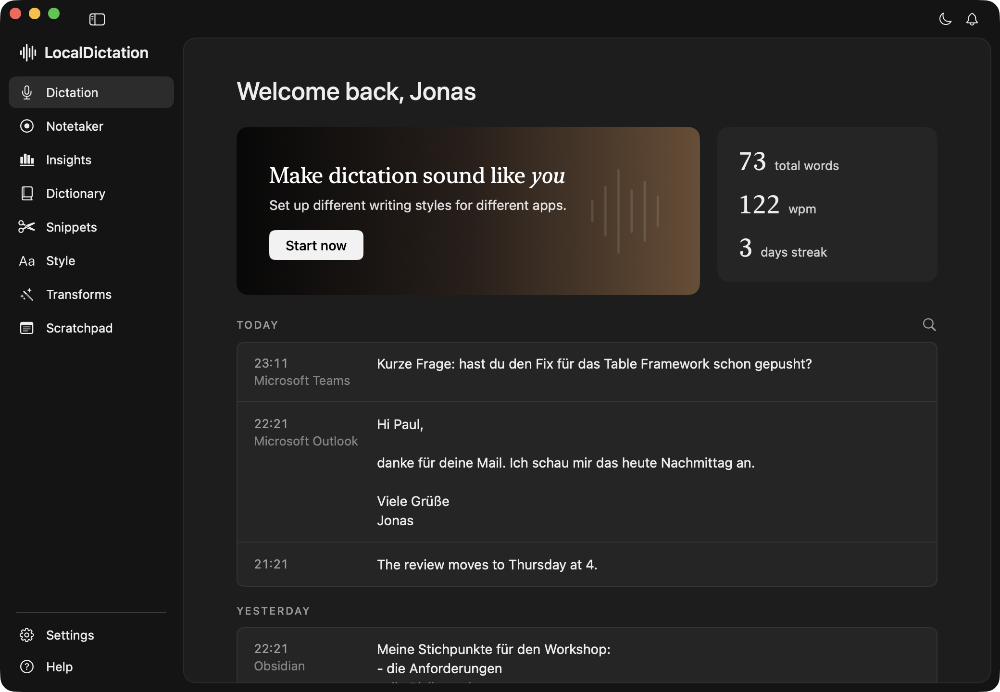
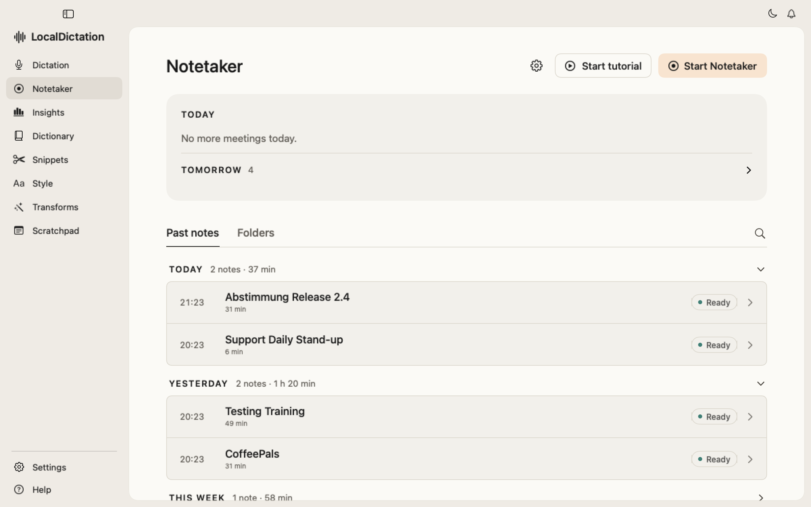
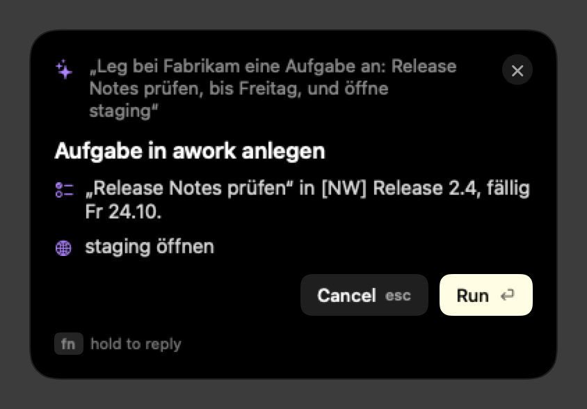
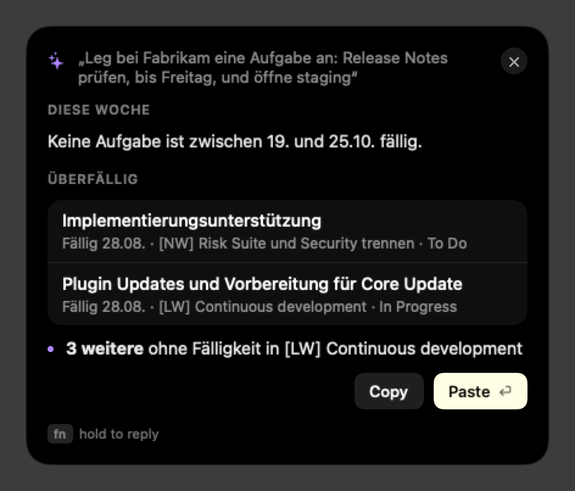
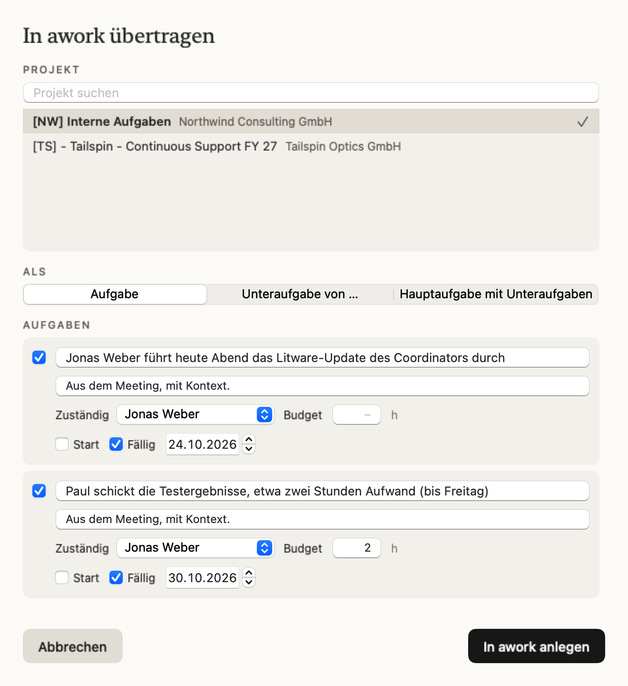
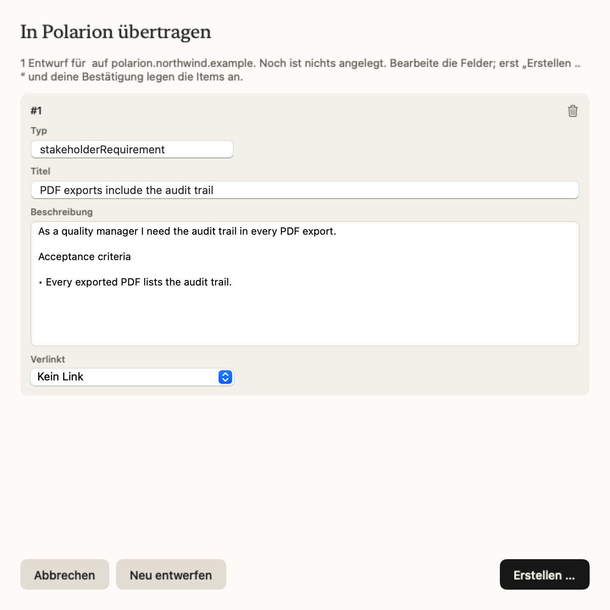
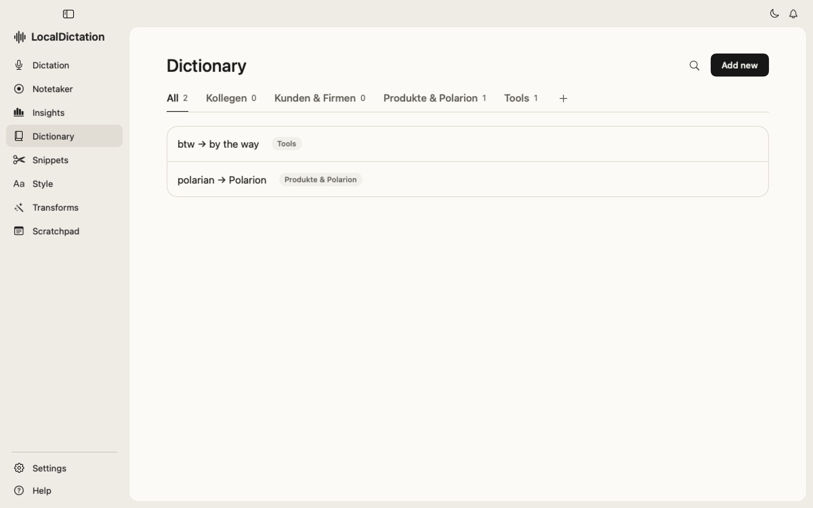
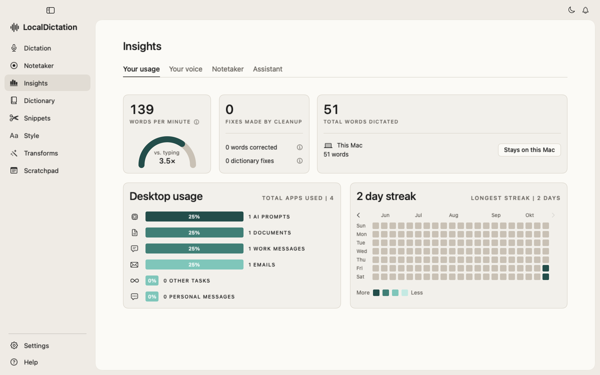

# LocalDictation

I wanted dictation and meeting notes like Wispr Flow and Granola, without sending my voice to a cloud in the US. So I built a macOS menu bar app that does it on my own Mac, plus a small assistant for my daily work.



The full promo video (82 seconds) is in [docs/promo.mp4](docs/promo.mp4).

## What it does

Dictation: I hold Fn, speak and let go. Whisper turns the speech into text on the Mac, a small local language model cleans it up (fillers, self-corrections, lists, numbers) and the text lands in the app in front. Each app gets its own style, and there is a dictionary and snippets. German and English can be mixed in one dictation. Long dictations are processed in sections while I am still speaking.

Notetaker: it records the microphone and the system audio as two tracks, tells the speakers apart, writes notes and action items and exports them to an Obsidian vault. Before a calendar meeting it shows a briefing with the open points from last time, and after it drafts the follow-up mail. Action items go to awork as tasks or to Polarion as backlog items. Polarion is a tool that medical-device and pharma companies use to document their products for approval.

Assistant: Fn and Option hand a spoken request to Claude Code or Codex with their tools. Questions are answered right away. Anything that would change something, like creating a task, waits until I press Return.

Speech recognition and cleanup run locally. Notes and the assistant use Claude Code or Codex.

The decision I care most about is where the cleanup runs. A call to a cloud model adds several seconds to every dictation, so cleanup stays on a 4B model in LM Studio (or Apple Intelligence). Only the slower jobs like meeting notes go to Claude, and when that call fails the local model takes over.

From release of the key to text it takes 2.3 to 2.65 seconds for short dictations. Since long dictations are processed while I speak, a 44 second dictation went from 7.4 to 3.1 seconds and a 2 minute dictation from 15.8 to 4.0 seconds. On my own dictations the word error rate is 1.3 percent.

## Run the demo

Demo with invented data. The original runs inside a company environment, so in demo mode awork, the Polarion backlog, the calendar and the assistant's agent answer from fixtures instead of real systems. Dictation itself works as usual.

You need a Mac with Apple silicon, macOS 14 or later and the Swift toolchain (the Command Line Tools are enough).

```sh
swift build
DEMO_MODE=1 .build/debug/LocalDictation            # or: .build/debug/LocalDictation --demo
DEMO_MODE=1 .build/debug/LocalDictation --demo-reset   # starts again with fresh demo data
```

The demo keeps its files in `~/Library/Application Support/LocalDictation Demo`, apart from normal use. The first start downloads the Whisper model. For the text cleanup, LM Studio with `qwen/qwen3-4b-2507` should run; without it the raw transcript is pasted. On macOS 27 with only the Command Line Tools, build with `SDKROOT` pointing to the macOS 26 SDK (`scripts/test.sh` and `scripts/bundle.sh` do that on their own).

Tests: `scripts/test.sh`. All panels as PNG files: `.build/debug/LocalDictation --render-snapshots /tmp/shots`. The real install: `scripts/bundle.sh`.

Outside the demo, the company connections are empty until they are configured: `AWORK_WORKSPACE_URL` for task links, `LD_OWN_DOMAIN` for telling internal from external meetings, and the Polarion server and MCP program under Settings, Connectors.

## Screenshots

| | |
|---|---|
|  |  |
|  |  |
|  |  |
|  |  |

Stack: Swift 6 toolchain, AppKit and SwiftUI, WhisperKit, SpeakerKit, FluidAudio, Qwen3-4B in LM Studio or Apple Intelligence, Claude Code or Codex, Python for the evaluation scripts, the promo made with HyperFrames and GSAP.
